# Jaime0

**Jaime0 es un sistema operativo personal hecho a medida de un portátil: el Acer Nitro AN515-55.** Es Debian con un escritorio montado pieza a pieza alrededor de Hyprland. Se prueba desde un USB sin tocar el disco, se instala con un asistente gráfico y funciona nada más instalarlo: el firmware, los controladores, el navegador y los visores ya vienen dentro.

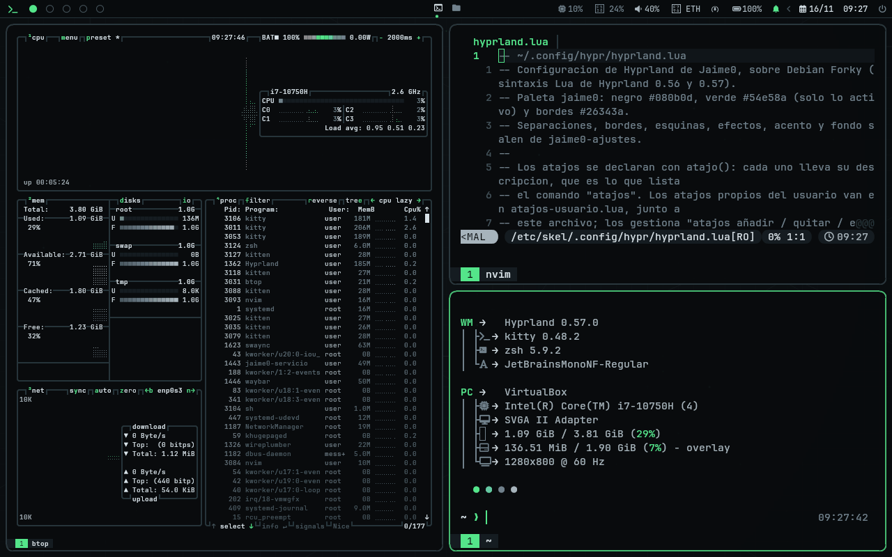

> **Estado:** en desarrollo. La última versión publicada es la **0.4.0-beta.1**, la primera con el Control Center. Se ha probado en máquinas virtuales; **todavía no en el portátil** (ver [docs/pruebas.md](docs/pruebas.md)).

## Qué lleva y por qué

| Pieza | Qué es | Por qué |
|---|---|---|
| **Debian Forky** (testing) | La base: núcleo, programas y `apt` | Estable y conocida, pero con programas recientes (Hyprland avanza muy deprisa). Al ser testing, alguna actualización puede romper algo: por eso hay [instantáneas](#actualizar-y-volver-atrás) |
| **Hyprland** | Gestor de ventanas en mosaico (Wayland) | Coloca las ventanas solas, una junto a otra, y todo tiene atajo. También se puede usar con ratón |
| **Waybar** | La barra de arriba | Fina y sin gastar: solo se redibuja cuando algo cambia |
| **Control Center** | Ventana de estado y control del sistema | Ver de un vistazo cómo está el equipo, cambiar de perfil y automatizar cosas, sin telemetría |
| **Intel + NVIDIA** | Dos gráficas | La Intel dibuja el escritorio y gasta poco; la NVIDIA está apagada hasta que la pides. Más batería y menos calor |
| **Seguridad** | Cortafuegos (UFW), Secure Boot y cifrado opcional (LUKS) | No entra nada que no hayas abierto; el arranque sigue siendo seguro; sin la clave nadie lee el disco |
| **Herramientas propias** | `jaime0-ajustes`, `jaime0-anclar`, `atajos`... | Cambiar el aspecto y el comportamiento sin editar archivos a mano |
| **Programas** | Brave, mpv, imv, zathura, file-roller, Kitty, Thunar, btop, Neovim | Lo básico ya instalado: navegar, vídeo, imágenes, PDF, comprimidos, terminal y archivos |

Ligero: unos 600 MiB de RAM con la sesión abierta y arranque en unos 25 s (medido en una máquina virtual). Más detalle de cómo encaja todo en [docs/arquitectura.md](docs/arquitectura.md).

**La barra.** A la izquierda, los escritorios (el verde es el actual); en el centro, las aplicaciones ancladas; a la derecha, CPU, memoria, volumen y red, el icono de Jaime0 (perfil y estado; abre el Control Center), batería, notificaciones, fecha, hora y menú de energía. Cada indicador abre su herramienta al pulsarlo.

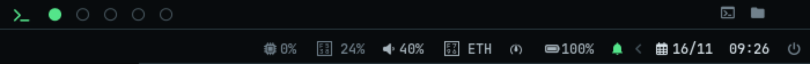

| Escritorio al entrar | Con widgets (opcionales) |
|---|---|
|  | 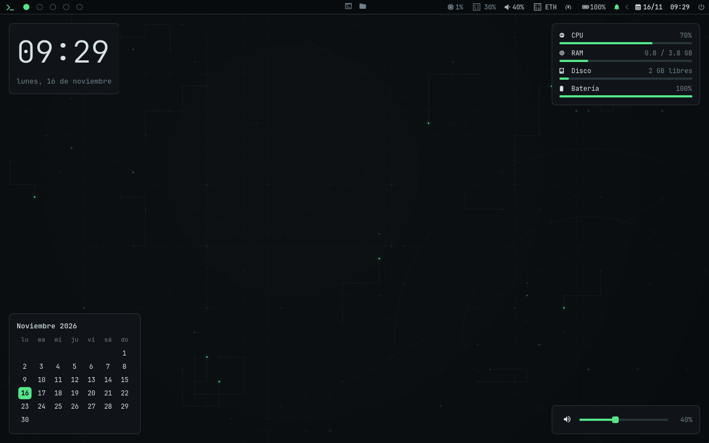 |

## Instalar

1. **Consigue la ISO.** El repositorio es privado: descárgala de [Releases](https://github.com/Jaime-202/jaime0/releases) o compílala ([docs/compilar.md](docs/compilar.md)).
2. **Grábala en un USB** de 4 GB o más (se borra entero).
   - Windows: [Rufus](https://rufus.ie), elige la ISO y el **modo Imagen DD**.
   - Linux (cambia `/dev/sdX` por tu USB; compruébalo con `lsblk`):

     ```bash
     sudo dd if=jaime0-amd64.hybrid.iso of=/dev/sdX bs=4M status=progress oflag=sync
     ```
3. **Arranca desde el USB:** con el portátil apagado, enciéndelo pulsando **F12** y elige el USB. Secure Boot puede seguir activado. Entra solo en la sesión en vivo (usuario `user`, contraseña `live`).
4. **Instala:** `SUPER + Espacio` y busca **Instalar el sistema**. Puedes borrar el disco, instalar junto a Windows o particionar a mano, con cifrado opcional y con ext4 o Btrfs.
5. **Primer arranque:** entra con tu usuario. Si aparece el aviso de la NVIDIA, registra su clave una vez: `jaime0-nvidia registrar`, reinicia y elige **Enroll MOK** en la pantalla azul ([docs/nvidia.md](docs/nvidia.md)). Hasta entonces todo va con la Intel.

¿Pantalla en negro? En el menú de arranque elige **Modo seguro**.

| Instalador | Elegir el disco | Acceso tras instalar |
|---|---|---|
| 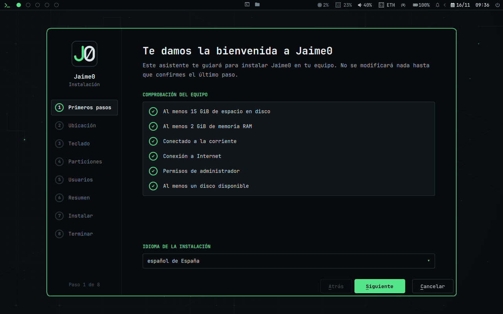 | 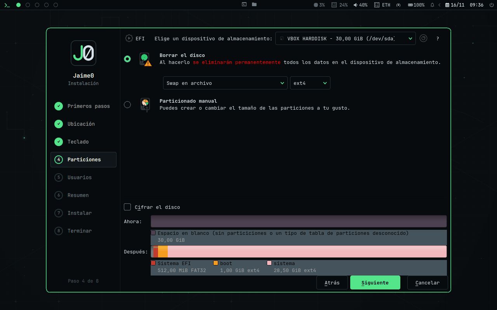 |  |

## Cómo se usa

### Lo básico

| Atajo | Qué hace |
|---|---|
| `SUPER + Intro` | Terminal |
| `SUPER + Espacio` | Buscar y abrir aplicaciones |
| `SUPER + Q` | Cerrar la ventana |
| `SUPER + 1-9` / `SUPER + SHIFT + 1-9` | Ir a un escritorio / mover la ventana a él |
| `SUPER + flechas` | Moverte entre ventanas |
| `SUPER + F` / `SUPER + V` | Pantalla completa / ventana flotante |
| `SUPER + E` / `SUPER + B` | Archivos (Thunar) / navegador |
| `SUPER + I` | Control Center |
| `SUPER + N` | Notificaciones |
| `SUPER + L` / `SUPER + Escape` | Bloquear / menú de energía |
| `Impr Pant` | Captura de un área (a `Imágenes/Capturas` y al portapapeles) |
| `SUPER + F1` | **Todos los atajos** |

El comando `atajos` muestra la lista real y permite añadir los tuyos (`atajos añadir "SUPER+O" "kitty -e nvim" "Abrir Neovim"`); comprueba la configuración antes de aplicar nada.

| Lanzador (`SUPER + Espacio`) | Atajos (`SUPER + F1`, con buscador) |
|---|---|
| 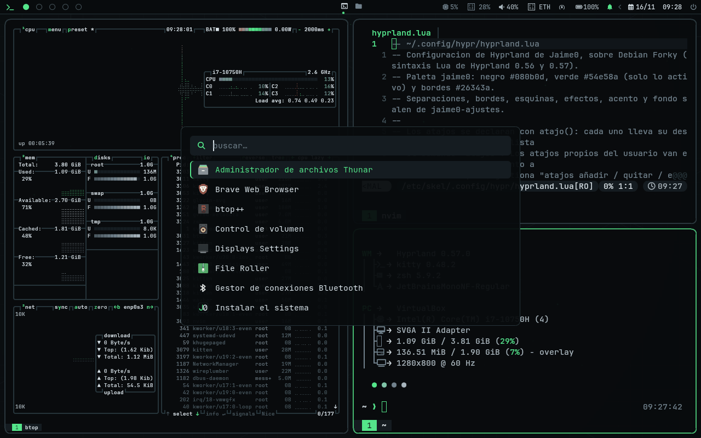 |  |
| **Notificaciones** (`SUPER + N`): no molestar y volumen | **Bloqueo** (`SUPER + L`, o sola tras 10 min sin uso) |
| 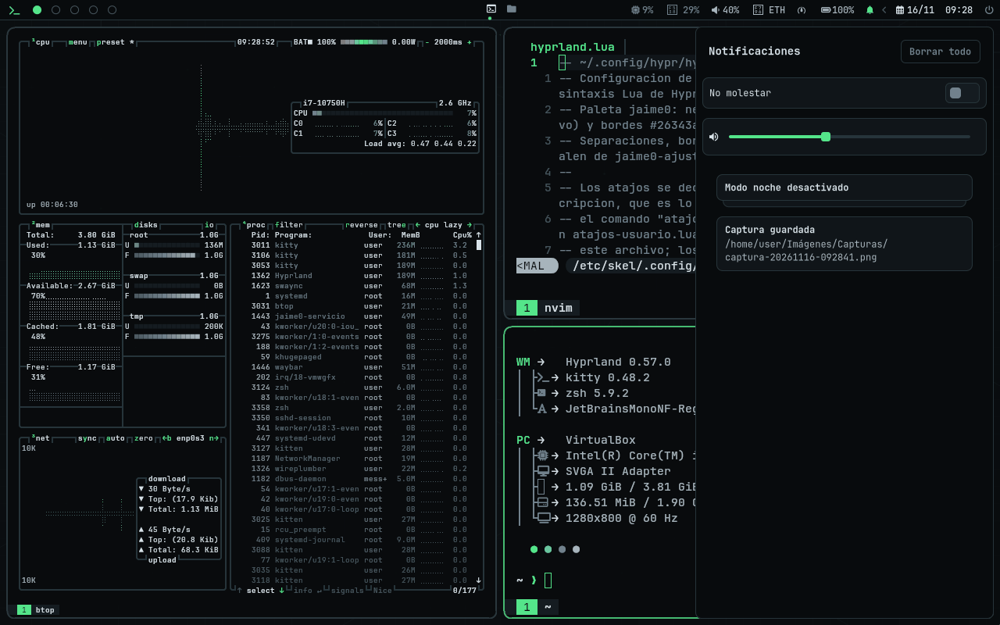 | 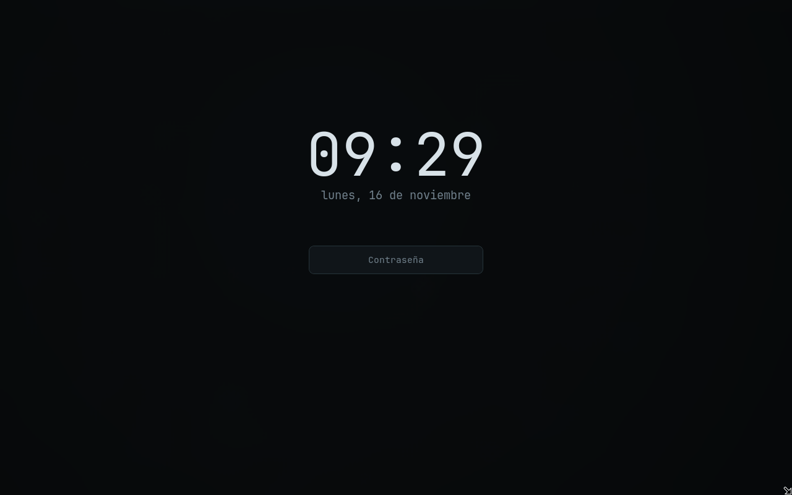 |

### Control Center

Se abre con `SUPER + I` o con el icono de Jaime0 de la barra (junto a la batería). Dentro, las teclas `1`–`7` cambian de sección y `Esc` cierra. Solo muestra datos reales: lo que el equipo no tiene sale como `N/D` o «no disponible», con el motivo (en las capturas, una máquina virtual sin sensores de temperatura ni NVIDIA).

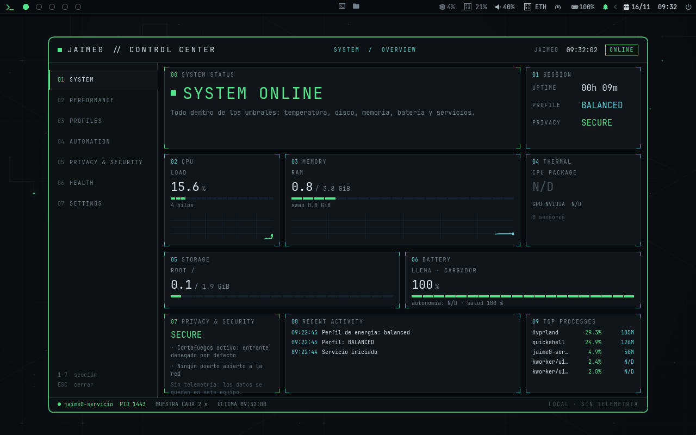

| Sección | Para qué sirve | En la terminal |
|---|---|---|
| **SYSTEM** | Resumen: estado general, CPU, memoria, disco, batería, temperatura y actividad reciente | `jaime0-salud` |
| **PERFORMANCE** | Núcleos, carga, memoria, presión y procesos que más gastan | |
| **PROFILES** | Perfiles: BALANCED, PERFORMANCE, POWER SAVER (ahorro), FOCUS (no molestar), MULTIMEDIA (sin bloqueo) y CUSTOM (el tuyo). Siempre se puede volver atrás | `jaime0-perfil poner focus`, `jaime0-perfil anterior` |
| **AUTOMATION** | Reglas «cuando pase esto → haz esto» (p. ej. batería baja → ahorro). Funcionan con la ventana cerrada | `jaime0-reglas lista` |
| **PRIVACY & SECURITY** | Cortafuegos, puertos abiertos, conexiones, micrófono y cámara en uso, telemetría | `jaime0-privacidad` |
| **HEALTH** | Gráficas e histórico, incidencias y modo diagnóstico | `jaime0-salud incidencias` |
| **SETTINGS** | Animaciones (no, sutil, suave), frecuencia de medida, umbrales de alerta, avisos y el atajo | `jaime0-ajustes` |

| PERFORMANCE | PROFILES |
|---|---|
| 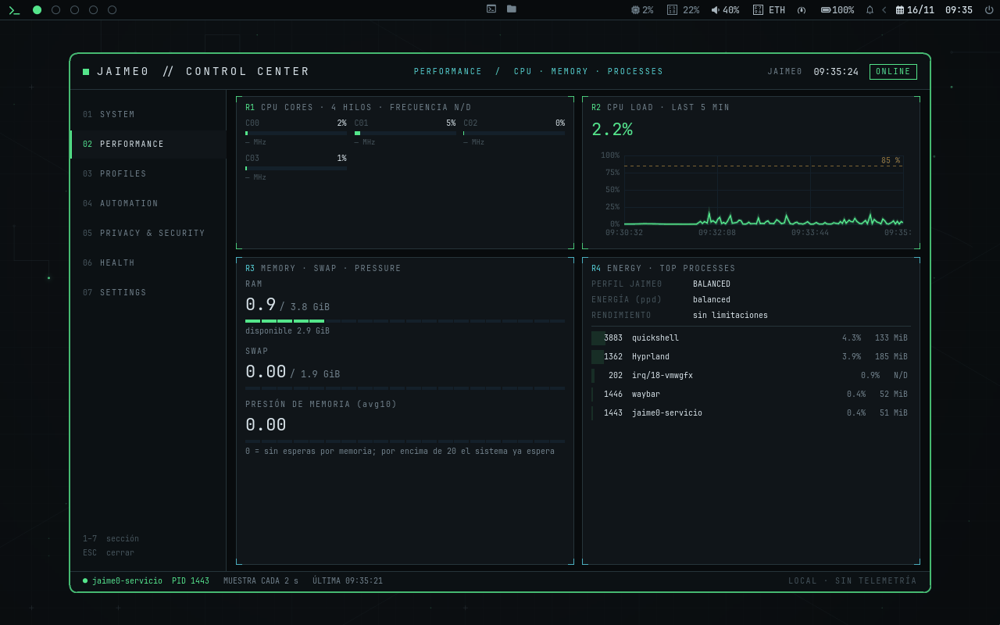 | 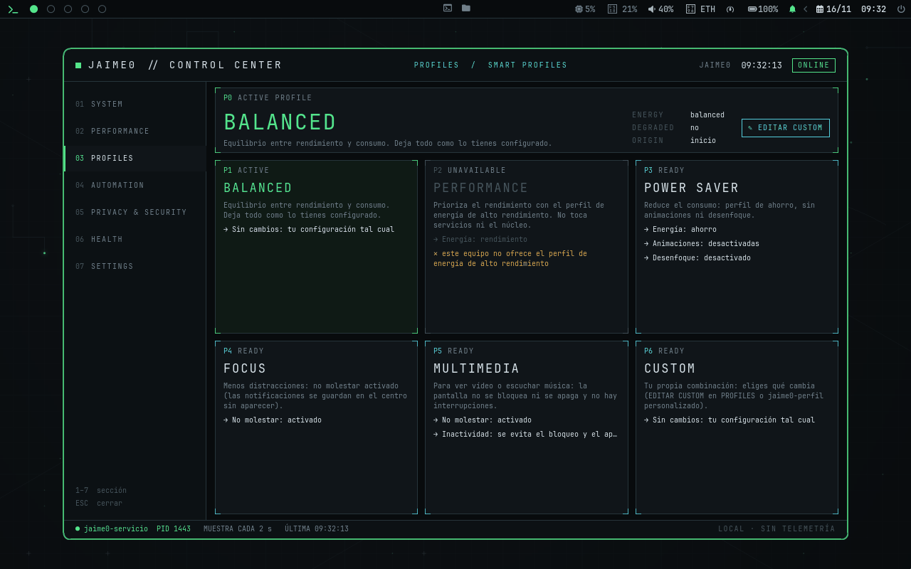 |
| **AUTOMATION** | **PRIVACY & SECURITY** |
| 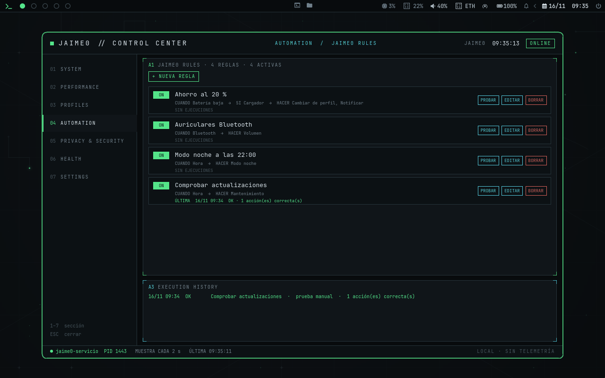 | 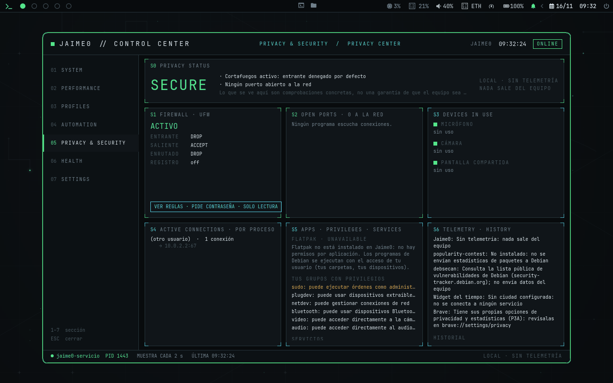 |
| **HEALTH** | **SETTINGS** |
| 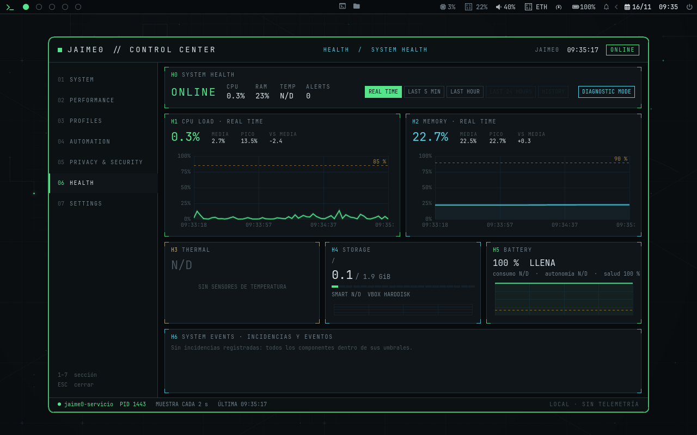 | 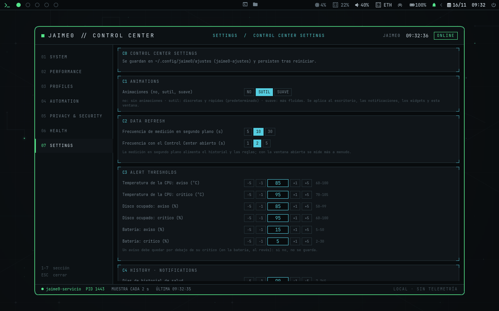 |

Lo hace funcionar `jaime0-servicio`, que se arranca con la sesión, usa unos 55 MiB y casi nada de CPU, y guarda el historial en `~/.local/state/jaime0`. Si la ventana no está instalada o el servicio se para, el resto del sistema sigue igual y el estado se ve con `jaime0-salud`. Más en [docs/control-center.md](docs/control-center.md).

### Cambiar el aspecto: `jaime0-ajustes`

```bash
jaime0-ajustes ver
```
```bash
jaime0-ajustes poner acento cian
```
```bash
jaime0-ajustes restablecer acento
```

Cambia el color de acento, el fondo, los bordes, las esquinas, el desenfoque, las animaciones, la barra y los widgets de escritorio (reloj, música, tiempo...). Se aplica al momento y se guarda en `~/.config/jaime0/ajustes`, que solo contiene lo que has cambiado. Sin argumentos abre su ventana. Todos los ajustes: [docs/ajustes.md](docs/ajustes.md).

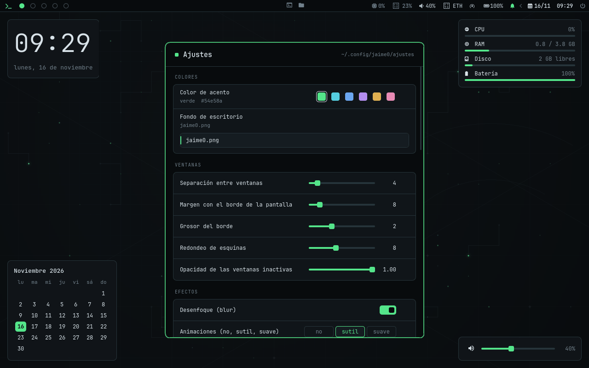

### Aplicaciones ancladas: `jaime0-anclar`

Hasta 6 aplicaciones en el centro de la barra; un punto marca las abiertas.

```bash
jaime0-anclar firefox
```
```bash
jaime0-anclar quitar thunar
```

### La NVIDIA: `prime-run`

```bash
prime-run programa
```

Abre ese programa con la NVIDIA (juegos, renderizado, CUDA). El resto del tiempo está apagada. `jaime0-nvidia` dice si el módulo está cargado y si falta registrar la clave. Detalles y HDMI: [docs/nvidia.md](docs/nvidia.md).

### Instalar programas

```bash
sudo apt install nombre-del-programa
```

Como en cualquier Debian. Brave se actualiza igual, desde su repositorio. Lo instalado en la sesión en vivo se pierde al reiniciar.

### Actualizar y volver atrás

- **Debian, Brave y la NVIDIA:** el icono de actualizaciones de la barra (o la orden `actualizaciones`) muestra lo pendiente, marca lo que corrige fallos de seguridad y lo instala cuando quieras. Nunca instala nada solo.
- **Lo propio de Jaime0:** llega con una ISO nueva.
- **Volver atrás:** si instalaste con **Btrfs**, se guarda una instantánea antes y después de cada actualización y se puede deshacer. Con ext4 no hay instantáneas. Ver [docs/actualizaciones.md](docs/actualizaciones.md) y [docs/recuperacion.md](docs/recuperacion.md).

### Si algo falla

- **No arranca el escritorio:** en GRUB, **Opciones avanzadas** → **(modo seguro)**. Jaime0 muestra la causa más probable y una consola para repararlo.
- **Informe del equipo** para una incidencia, sin datos personales (ni MAC, ni IP, ni usuario, ni números de serie):

  ```bash
  jaime0-diagnostico --sudo
  ```

## Documentación

| Documento | Contenido |
|---|---|
| [arquitectura.md](docs/arquitectura.md) | Cómo encajan las piezas, decisiones técnicas e identidad visual |
| [control-center.md](docs/control-center.md) | Control Center: diseño, formatos de datos y resultados de las pruebas |
| [ajustes.md](docs/ajustes.md) | Todos los ajustes, ancladas y widgets |
| [nvidia.md](docs/nvidia.md) | La gráfica NVIDIA y Secure Boot |
| [actualizaciones.md](docs/actualizaciones.md) / [recuperacion.md](docs/recuperacion.md) | Actualizar, instantáneas, cortafuegos y zram |
| [compilar.md](docs/compilar.md) | Compilar la ISO y estructura del repositorio |
| [pruebas.md](docs/pruebas.md) | Qué se ha probado, qué falta y problemas conocidos |

## Licencia

El trabajo original es [MIT](LICENSE). Lo derivado de otros proyectos y el software de la ISO conservan sus licencias: ver [CREDITS.md](CREDITS.md) y [SOURCES.md](SOURCES.md). Jaime0 no está afiliado al proyecto Debian.
