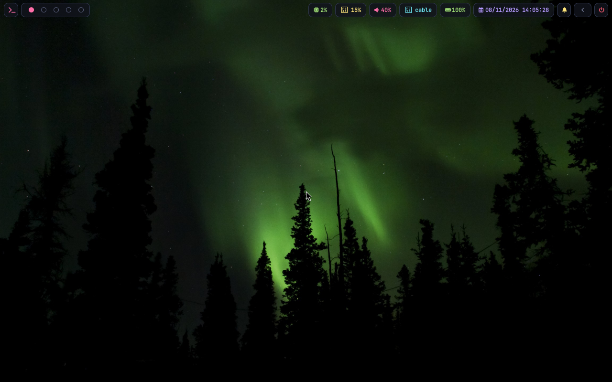
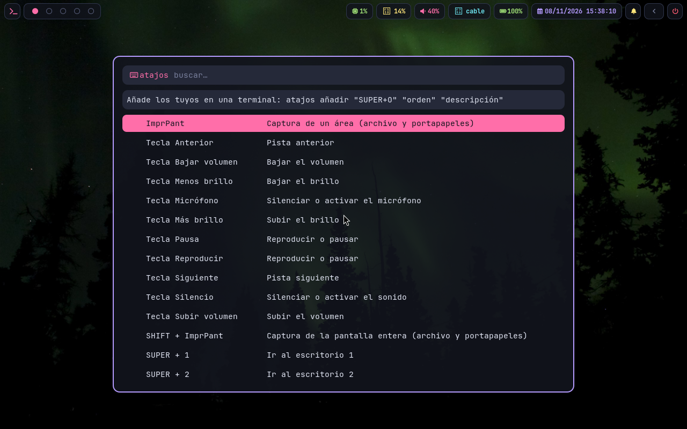
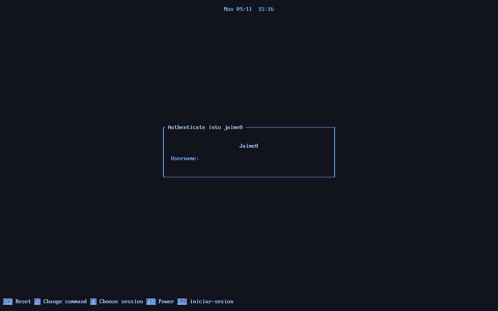

# Jaime0

**Jaime0 es un sistema operativo personal, hecho a medida de un portátil concreto.** Es un Linux que se prueba desde un USB sin tocar el disco y se instala con un asistente gráfico. Está pensado para un equipo rápido y ordenado, que se maneja sobre todo con el teclado sin renunciar al ratón, y que funciona nada más instalarlo: el firmware, los controladores, el navegador y los visores ya vienen dentro.

Por dentro es **Debian** (la misma base que usan miles de servidores y otras distribuciones) con un escritorio moderno montado pieza a pieza: **Hyprland** como gestor de ventanas, una barra fina, notificaciones, bloqueo de pantalla, widgets opcionales y herramientas propias para ajustarlo. Todo comparte la misma estética: negro profundo y un verde discreto que solo marca lo que está activo.


> **Estado:** en desarrollo (0.3.0-beta.1). Probado en máquinas virtuales; **todavía no en el portátil**. La ISO se instalará cuando esté terminada. Lo que falta por probar: [Qué no se ha probado](#qué-no-se-ha-probado).

## El equipo

Todo está elegido para este portátil:

| Pieza | Modelo | Qué hace Jaime0 con ella |
|---|---|---|
| Equipo | Acer Nitro AN515-55 | |
| Procesador | Intel Core i7-10750H (6 núcleos, 12 hilos) | Microcódigo de Intel; `thermald` para que no se caliente de más |
| Gráfica integrada | Intel UHD (Comet Lake) | Dibuja todo el escritorio; vídeo por hardware (VA-API) |
| Gráfica dedicada | NVIDIA GeForce GTX 1650 Ti | Apagada hasta que la pides con `prime-run`: juegos, renderizado, CUDA, HDMI. Ver [docs/nvidia.md](docs/nvidia.md) |
| Pantalla | 15,6" a 1920x1080 | Escala 1.25, como la usaba Windows |
| Memoria | 16 GiB | |
| Disco | SSD NVMe WD SN530 de 512 GB | Cifrado LUKS y Btrfs con instantáneas, opcionales en el instalador |
| Wi-Fi y Bluetooth | Intel AX201 (Wi-Fi 6) | Firmware incluido |
| Sonido | Intel Smart Sound (SOF) con códec Realtek | Firmware SOF incluido |
| Ethernet | Killer E2600 | Funciona sin firmware |
| Batería | | Perfiles de energía en la barra (ahorro, equilibrado, rendimiento) |
| Arranque | UEFI con Secure Boot activado | Arranca con Secure Boot; la NVIDIA pide registrar su clave una vez |

En otro equipo también arranca, pero solo lleva el firmware de este: el Wi-Fi o la gráfica de otro modelo pueden no funcionar.

## Qué es, explicado sin prisas

### Una distribución de Linux

Un sistema Linux se compone de muchas piezas hechas por proyectos distintos: el núcleo (Linux), los programas básicos, el gestor de paquetes, el escritorio... Una **distribución** elige esas piezas, las configura para que encajen y las entrega listas para instalar. Jaime0 es una distribución pequeña: no rehace lo que Debian ya hace bien y se centra en el escritorio y en cómo se usa el equipo.

### Basada en Debian Forky

Debian publica una versión estable cada dos años y, mientras tanto, prepara la siguiente en una rama llamada **testing**, que ahora se llama *Forky*. Jaime0 usa esa rama para tener programas recientes (Hyprland avanza muy deprisa). La contrapartida es que testing recibe cambios a diario y alguna actualización puede romper algo; por eso Jaime0 trae formas de volver atrás (ver más abajo).

Los programas se instalan como en cualquier Debian, con `apt` y desde los repositorios oficiales (Brave, desde el suyo).

### Wayland y Hyprland: ventanas en mosaico

En Linux, el programa que dibuja las ventanas en pantalla se llama **compositor**. Jaime0 usa **Wayland**, el sistema gráfico moderno que sustituye a X11, con **Hyprland** como compositor.

Hyprland organiza las ventanas **en mosaico** (*tiling*): en lugar de amontonarlas y obligarte a moverlas y redimensionarlas a mano, las coloca solas una junto a otra aprovechando toda la pantalla. Abres una terminal y ocupa la pantalla; abres otra y se reparten el espacio. Todo tiene atajo (`SUPER + Intro` abre una terminal, `SUPER + Q` cierra, `SUPER + 1-9` cambia de escritorio), pero también se puede usar el ratón y dejar cualquier ventana flotante.

### Dos gráficas, cada una a lo suyo

El portátil tiene una gráfica Intel, que gasta poco, y una NVIDIA, potente pero glotona. Jaime0 usa la Intel para todo el escritorio y deja la NVIDIA **apagada** hasta que un programa la necesita: `prime-run programa` lo abre con ella. Así la batería dura más y el portátil va más fresco. Como el equipo tiene Secure Boot, el controlador de NVIDIA se firma con una clave propia de tu instalación, que se registra una sola vez. Todo el detalle: [docs/nvidia.md](docs/nvidia.md).

### Ligero de verdad

Con el escritorio en reposo usa unos **530 MiB de RAM** y arranca en unos **15 segundos** (sistema instalado 0.2.0-beta.1, medido con `free -m` y `systemd-analyze` en una VM UEFI con 4 GiB). No hay trucos: no corre nada que no haga falta, la barra no pregunta el estado cada segundo sino que espera a que algo cambie, el soporte para programas antiguos de X11 (XWayland) viene apagado y los widgets, si no los activas, ni siquiera se cargan.

### Cómo encajan las piezas

| Capa | Qué hace | Con qué |
|---|---|---|
| Arranque | Menú de arranque, cifrado del disco, animación de inicio | GRUB, shim firmado (Secure Boot), LUKS, Plymouth |
| Acceso | Pide usuario y contraseña en una pantalla de texto | `greetd` con `tuigreet` |
| Escritorio | Dibuja y organiza las ventanas, en la gráfica Intel | Hyprland, con configuración en Lua |
| Barra y widgets | Escritorios, aplicaciones ancladas, energía, estado y hora; reloj, música, tiempo... | Waybar (parcheado), Quickshell |
| Servicios de la sesión | Notificaciones, bloqueo, inactividad, indicador de volumen, modo noche | swaync, Hyprlock, Hypridle, wob, Hyprsunset |
| Herramientas de Jaime0 | Ajustes, ancladas, atajos, NVIDIA, actualizaciones, diagnóstico | `jaime0-ajustes`, `jaime0-anclar`, `atajos`, `jaime0-nvidia`, `prime-run`, `actualizaciones`, `jaime0-diagnostico` |
| Sistema | Paquetes, red, sonido, Bluetooth, energía | Debian Forky: `apt`, NetworkManager, PipeWire, BlueZ, power-profiles-daemon |

Más detalle en [docs/arquitectura.md](docs/arquitectura.md).

### Seguro por defecto

- **Cortafuegos activo** (UFW): el equipo sale a internet con normalidad, pero no acepta conexiones entrantes que no hayas abierto tú.
- **Cifrado del disco opcional** (LUKS) desde el instalador: sin la clave, nadie puede leer tus datos aunque se lleve el portátil.
- **Secure Boot:** arranca con el cargador y el núcleo firmados por Debian, sin desactivar el arranque seguro. El módulo de NVIDIA, con tu propia clave.
- **Avisos de seguridad:** la barra indica cuándo hay actualizaciones de Debian que corrigen fallos de seguridad.

### Actualizar y volver atrás

- **Programas y sistema** (Debian, Brave, el controlador de NVIDIA): con `apt`. El comando `actualizaciones` (o el icono de la barra) muestra lo pendiente y lo instala cuando quieras.
- **Lo propio de Jaime0** (configuración, scripts, temas): llega con una ISO nueva.

Si al instalar eliges el sistema de archivos **Btrfs**, se guarda una **instantánea** del sistema antes y después de cada actualización (con *snapper*), y los cambios de paquetes se pueden deshacer con una orden. Con ext4, la opción por defecto, no hay instantáneas. Ver [docs/actualizaciones.md](docs/actualizaciones.md) y [docs/recuperacion.md](docs/recuperacion.md).

| Escritorio al entrar | Lista de atajos |
|---|---|
|  |  |
| **Instalador** | **Acceso** |
|  |  |

## Características

- **Barra fina** (26 px), opaca y continua: escritorios a la izquierda, aplicaciones ancladas en el centro y estado y hora a la derecha. El reloj se redibuja una vez por minuto, y la campana y las ancladas solo cuando cambian.
- **Aplicaciones ancladas:** hasta 6 en el centro de la barra. Un punto marca las abiertas; al pulsar, se enfoca su ventana o se inicia. Se gestionan con `jaime0-anclar` o desde `jaime0-ajustes`.
- **Widgets de escritorio** opcionales (Quickshell): reloj, música, tiempo, volumen y brillo, sistema y calendario, cada uno donde elijas. Ver [docs/ajustes.md](docs/ajustes.md#widgets-de-escritorio).
- **Ajustes en un solo sitio:** `jaime0-ajustes`, en la terminal o con su ventana, cambia acento, fondo, separación, bordes, esquinas, opacidad, desenfoque, animaciones y la barra, y lo aplica al momento.
- **Notificaciones y bloqueo:** centro de notificaciones con no molestar y controles de música; pantalla de bloqueo con la hora y la canción que suena; bloqueo automático por inactividad y al cerrar la tapa.
- **Ya instalados:** Brave (navegador), mpv (vídeo y música), imv (imágenes), zathura (PDF) y file-roller (comprimidos), abiertos al pulsar un archivo en Thunar.
- **Comando `atajos`:** lista todos los atajos reales y permite añadir los tuyos, comprobando antes que la configuración es válida.
- **Instalador gráfico** (Calamares): borrar el disco, instalar junto a otro sistema o particionar a mano, con cifrado opcional, ext4 o Btrfs, y sin necesidad de red.
- **Modo seguro** en el menú de arranque, por si la gráfica da problemas.

## Instalación

### 1. Compilar y comprobar la ISO

El repositorio es privado y la ISO no se publica: se compila con los pasos de [Reconstruir la ISO](#reconstruir-la-iso). Al terminar, guarda su suma para comprobar la copia del USB:

```bash
sha256sum jaime0-amd64.hybrid.iso
```

En Windows:

```powershell
Get-FileHash .\jaime0-*-amd64.iso -Algorithm SHA256
```

### 2. Grabar en un USB

Grabar **borra todo el contenido del USB** (4 GB o más).

**Windows, con [Rufus](https://rufus.ie):** elige la ISO, pulsa **Empezar** y selecciona **Escribir en modo Imagen DD**. El modo ISO de Rufus no se ha probado.

**Linux**, sustituyendo `/dev/sdX` por tu USB (compruébalo antes con `lsblk`):

```bash
sudo dd if=jaime0-amd64.hybrid.iso of=/dev/sdX bs=4M status=progress oflag=sync
```

### 3. Arrancar e instalar

Con el portátil apagado, enchufa el USB, enciéndelo pulsando **F12** (menú de arranque de Acer; si no aparece, actívalo en la BIOS con F2, pestaña **Main**, **F12 Boot Menu**) y elige el USB. Secure Boot puede quedarse activado. El sistema entra solo en la sesión en vivo.

| Dato | Valor |
|---|---|
| Usuario en vivo | `user` |
| Contraseña en vivo | `live` |
| Instalar | `SUPER + Espacio` y busca **Instalar el sistema** |
| Acceso tras instalar | Pantalla de texto: usuario, Intro, contraseña, Intro |

El usuario que crees en el instalador hereda toda la configuración. El equipo se llama `jaime0` por defecto. Al final de la instalación se compila el módulo de NVIDIA con una clave nueva: tarda unos minutos.

Con cifrado, `/boot` queda sin cifrar y la clave se pide una sola vez al arrancar. El registro del instalador queda en `~/instalador.log` de la sesión en vivo.

### 4. Primer arranque: la NVIDIA

Al entrar por primera vez aparece un aviso: la NVIDIA necesita que registres su clave **una vez** (por Secure Boot). Abre una terminal, ejecuta `jaime0-nvidia registrar`, reinicia y, en la pantalla azul, elige **Enroll MOK**. Los pasos, con detalle: [docs/nvidia.md](docs/nvidia.md#la-primera-vez-registrar-la-clave-secure-boot). Hasta entonces todo funciona con la Intel.

### Si la pantalla se queda en negro o no entra al escritorio

En el menú de arranque del USB elige **Modo seguro**, que arranca con `nomodeset`. En un sistema ya instalado, elige en GRUB **Opciones avanzadas** y la entrada **(modo seguro)**.

Si Hyprland no puede abrirse, Jaime0 muestra un mensaje con la causa más probable y una consola para reparar el sistema. Con `nomodeset` la gráfica queda desactivada, así que el escritorio no llegará a abrirse: ese modo sirve para entrar y arreglar el controlador.

## Uso

### Atajos de teclado

`SUPER + F1` o el comando `atajos` muestran siempre la lista completa y real.

**Programas y menús**

| Atajo | Acción |
|---|---|
| `SUPER + Intro` | Terminal (Kitty) |
| `SUPER + Espacio` | Lanzador de aplicaciones |
| `SUPER + R` | Ejecutar una orden |
| `SUPER + Tab` | Cambiar de ventana (lista) |
| `SUPER + E` | Thunar |
| `SUPER + B` | Navegador (avisa si no hay ninguno instalado) |
| `CTRL + SHIFT + Esc` | Monitor del sistema (btop) |
| `SUPER + A` | Control de sonido |
| `SUPER + W` | Red y Wi-Fi |
| `SUPER + SHIFT + V` | Historial del portapapeles |
| `SUPER + N` / `SUPER + SHIFT + N` | Centro de notificaciones / borrar todas |
| `SUPER + F2` | Modo noche (tonos cálidos) |
| `SUPER + SHIFT + C` | Selector de color (copia el color en hexadecimal) |
| `SUPER + L` | Bloquear la pantalla |
| `SUPER + Escape` | Menú de energía |
| `SUPER + SHIFT + R` | Recargar la configuración de Hyprland |
| `SUPER + F1` | Lista de todos los atajos |

**Ventanas y escritorios**

| Atajo | Acción |
|---|---|
| `SUPER + Q` | Cerrar ventana |
| `SUPER + F` / `SUPER + M` | Pantalla completa / maximizar |
| `SUPER + V` / `SUPER + C` | Ventana flotante / centrarla |
| `SUPER + J` / `SUPER + P` | Cambiar la orientación del mosaico / pseudo-mosaico |
| `SUPER + flechas` | Mover el foco |
| `SUPER + SHIFT + flechas` | Mover la ventana a izquierda, derecha, arriba o abajo |
| `SUPER + CTRL + flechas` | Redimensionar la ventana |
| `SUPER + 1-9` / `SUPER + SHIFT + 1-9` | Ir a un escritorio / mover la ventana a él |
| `SUPER + Retroceso` | Volver al escritorio anterior |
| `SUPER + rueda del ratón` | Escritorio siguiente o anterior |
| `SUPER + arrastrar` (clic izquierdo / derecho) | Mover / redimensionar con el ratón |
| Arrastrar el borde de una ventana | Redimensionarla |

**Capturas y teclas especiales**

| Atajo | Acción |
|---|---|
| `Impr Pant` | Captura de un área |
| `SHIFT + Impr Pant` | Captura de la pantalla entera |
| `SUPER + Impr Pant` | Captura de la ventana activa |
| Teclas de volumen, silencio y micrófono | Subir, bajar, silenciar (con indicador en pantalla) |
| Teclas de brillo | Subir o bajar el brillo |
| Teclas de reproducción | Reproducir o pausar, pista siguiente o anterior |

Las capturas van a `Imágenes/Capturas` y al portapapeles. La pantalla se bloquea a los 10 minutos sin uso, se apaga al minuto siguiente y el equipo se suspende a los 30 minutos (en la sesión en vivo no).

### Ajustes

```bash
jaime0-ajustes ver
```
```bash
jaime0-ajustes poner acento cian
```
```bash
jaime0-ajustes poner barra_posicion abajo
```

Cada cambio se aplica al momento y se guarda en `~/.config/jaime0/ajustes`, que solo contiene lo que has cambiado. `jaime0-ajustes restablecer CLAVE` vuelve al valor de fábrica. Todos los ajustes y sus límites: [docs/ajustes.md](docs/ajustes.md).

### Aplicaciones ancladas

```bash
jaime0-anclar firefox
```
```bash
jaime0-anclar quitar thunar
```
```bash
jaime0-anclar mover firefox 1
```

`jaime0-anclar` sin argumentos muestra las ancladas y `jaime0-anclar disponibles`, las que se pueden anclar. El nombre puede ser corto: `firefox` encuentra `firefox-esr`. Vienen ancladas Kitty y Thunar, y puedes quitarlas. Detalles en [docs/ajustes.md](docs/ajustes.md#aplicaciones-ancladas).

### Notificaciones, bloqueo y pantallas

- **Notificaciones:** Sway Notification Center. La campana de la barra abre el centro (también `SUPER + N`), con no molestar, controles de música y volumen. El clic derecho en la campana activa o desactiva el modo no molestar.
- **Bloqueo:** Hyprlock muestra la hora, la fecha, la canción que suena y la contraseña sobre el fondo de escritorio difuminado. Hypridle bloquea a los 10 minutos, apaga la pantalla a los 11, suspende a los 30 y bloquea siempre antes de suspender. Si Hyprlock fallara, la sesión sigue bloqueada con swaylock.
- **Volumen y brillo:** las teclas muestran una barra fina (wob) del color de acento.
- **Pantallas:** busca **Pantallas** (nwg-displays) en el lanzador. Lo que guardes ahí se aplica con la configuración Lua de Hyprland.

### El comando `atajos`

Lee la configuración que Hyprland tiene cargada, así que la lista siempre es la real.

```bash
atajos
```
```bash
atajos añadir "SUPER+O" "kitty -e nvim" "Abrir Neovim"
```
```bash
atajos quitar "SUPER+O"
```
```bash
atajos editar
```

Antes de aplicar un cambio, `atajos` comprueba la configuración con `Hyprland --verify-config`; si hay un error, no cambia nada. Los atajos propios se guardan en `~/.config/hypr/atajos-usuario.lua`.

### Instalar programas

Jaime0 usa los repositorios de Debian Forky, así que se instala con `apt`:

```bash
sudo apt update
```
```bash
sudo apt install nombre-del-programa
```

Lo instalado desde la sesión en vivo se pierde al reiniciar.

Brave ya viene instalado desde su repositorio oficial y se actualiza con `apt`; ábrelo con `SUPER + B`. Para otro navegador, por ejemplo Firefox:

```bash
sudo apt install firefox-esr firefox-esr-l10n-es-es
```

Solo están bloqueados los escritorios completos, `nautilus`, `dolphin` y Xorg.

### Programas X11

XWayland viene instalado pero apagado, y así se ahorran unos 120 MB. Para usar un programa X11, cambia `enabled = false` por `true` en el bloque `xwayland` de `~/.config/hypr/hyprland.lua` y vuelve a iniciar la sesión.

### Probar en VirtualBox

Activa la aceleración 3D (`--accelerate-3d on --vram 128`) y usa ratón de tipo tableta USB (`--mouse usbtablet`). Sin 3D, Hyprland no arranca.

Dentro de una VM, Jaime0 se aligera solo: los programas dibujan por software, se apagan el blur y las animaciones, el cursor se dibuja por software y la escala queda fija en 1. En hardware real no se aplica nada de esto.

En Windows con la **Integridad de memoria** activada, VirtualBox funciona sobre Hyper-V y va bastante más lento, incluido el ratón.

## Paleta

Negro profundo `#080b0d` y negro secundario `#101519` de base, bordes `#26343a`, gris claro `#d8e2e8` y gris secundario `#71818c` para el texto, y un único acento verde `#54e58a` para lo importante: ventana y escritorio activos, selección y botón principal. El cian `#55cde0` aparece solo como acento secundario. Tonos derivados: superficie `#151c21`, gris medio `#a7b4bc`, gris apagado `#45545c` y blanco de selección `#eef4f7`. El rojo `#d9625b` y el ámbar `#d9a54a` solo avisan de errores. La consola de texto (`vt.default_*`), el acceso y los 16 colores ANSI de Kitty usan la misma paleta, con los colores de `git` y `ls` apagados pero distinguibles.

El fondo de pantalla es propio: una malla digital oscura con líneas geométricas y pequeños puntos verdes, generada de forma determinista con `scripts/generar-fondo.py` (Python y Pillow) y guardada en el repositorio. La compilación no descarga nada para él.

## Qué lleva

| Área | Programas |
|---|---|
| Escritorio | Hyprland, Waybar, Rofi, swaybg, `lxpolkit`, Quickshell (aplicación de ajustes) |
| Notificaciones, bloqueo y OSD | Sway Notification Center, Hyprlock e Hypridle (swaylock de respaldo), wob |
| Utilidades | Hyprsunset (modo noche), Hyprpicker (selector de color), nwg-displays (pantallas) |
| Acceso | `greetd` con `tuigreet`, en la consola |
| Terminal | Kitty, Zsh, Starship, Fastfetch, btop, Neovim |
| Archivos | Thunar, con `gvfs` para montar USB al pulsarlos |
| Sistema | PipeWire con `pavucontrol`, NetworkManager (`nmtui`), Bluetooth con `blueman`, portapapeles, capturas, firmware del portátil |
| Programas | Brave, mpv, imv, zathura, file-roller |
| Gráficas y energía | VA-API de Intel, controlador propietario de NVIDIA (offload, `prime-run`), power-profiles-daemon, thermald |
| Herramientas | `git`, `curl`, `wget`, `unzip`, `openssh-client`, `atajos` |
| Arranque e instalación | Plymouth, GRUB, shim firmado, `cryptsetup` y Calamares; `os-prober` y `ntfs-3g` para convivir con otros sistemas |

La red se gestiona desde la barra, con `nmtui`, y el Bluetooth con `blueman-manager`.

## Reconstruir la ISO

Hace falta un Debian 13 (recomendado en una máquina virtual dedicada) con unos 30 GB libres y conexión a internet:

```bash
sudo apt install live-build debootstrap squashfs-tools xorriso mtools dosfstools grub-pc-bin grub-efi-amd64-bin python3 git openssl
```

1. Clona el repositorio y entra en él. En adelante se trabaja desde esta carpeta.

2. Da permisos de ejecución:

   ```bash
   chmod +x auto/* config/hooks/normal/*.hook.* config/includes.chroot_after_packages/usr/local/bin/* config/includes.chroot_after_packages/usr/local/sbin/* config/includes.chroot_after_packages/usr/lib/live/config/* scripts/*.sh
   ```

3. Completa la carpeta del menú de GRUB con las plantillas que faltan, sin pisar las propias:

   ```bash
   cp -an /usr/share/live/build/bootloaders/grub-pc/. config/bootloaders/grub-pc/
   ```

4. Compila Waybar parcheado en un chroot de Forky desechable, con `/proc` montado y red, y deja el paquete en `config/packages.chroot/`:

   ```bash
   sudo ./scripts/construir-waybar.sh /ruta/al/chroot-forky config/packages.chroot
   ```

5. Compila:

   ```bash
   lb config
   ```
   ```bash
   sudo lb build
   ```

   La compilación descarga el repositorio de Brave y compila el módulo de NVIDIA para el núcleo de la ISO (unos minutos más).

6. Para verificarlo, copia los scripts junto a `chroot/` y ejecútalos. Instalan herramientas de prueba en `chroot/`, así que hay que hacerlo después de generar la ISO:

   ```bash
   cp scripts/verificar-*.sh scripts/coords-*.sh scripts/atajos-prueba.sh . && ./verificar-todo.sh
   ```

   Las pruebas en vivo necesitan una VM con aceleración 3D. `scripts/coords-barra.sh` guarda las posiciones de los módulos de la barra a 1280 px: si cambia la barra, hay que volver a medirlas.

   Las comprobaciones que no necesitan la ISO (permisos, shellcheck, sintaxis de Python, JSON, Lua y QML, y las pruebas automáticas) están en `scripts/validar-repo.sh`, que GitHub Actions ejecuta en cada cambio. Qué se ha probado y qué falta: [docs/pruebas.md](docs/pruebas.md).

Para recompilar, ejecuta `sudo lb clean` y repite desde `lb config`. Forky cambia a diario: si llega otra versión de Hyprland, revalida la configuración con `Hyprland --verify-config`.

### Estructura del repositorio

| Ruta | Contenido |
|---|---|
| `auto/` | Opciones de live-build |
| `config/package-lists/` | Paquetes de la imagen |
| `config/hooks/normal/` | Ajustes que se aplican al compilar |
| `config/archives/` | Preferencias de APT: bloqueo de escritorios y Xorg, fijado de Waybar |
| `config/bootloaders/` | Menú y tema de GRUB del medio en vivo |
| `config/includes.chroot_after_packages/` | Archivos del sistema: `/etc/skel`, instalador, scripts |
| `scripts/` | Construcción de Waybar y traducciones, fondo y verificaciones |
| `pruebas/` | Pruebas automáticas (ajustes, ancladas, tiempo, diagnóstico) |
| `.github/workflows/` | Validación automática en GitHub Actions (no publica nada) |
| `docs/` | [Arquitectura](docs/arquitectura.md), [actualizaciones](docs/actualizaciones.md), [ajustes](docs/ajustes.md), [NVIDIA](docs/nvidia.md), [recuperación y seguridad](docs/recuperacion.md) y [pruebas](docs/pruebas.md) |
| `capturas/` | Capturas del sistema |

### Cambiar el nombre del sistema

Edita `PRODUCTO` en `config/includes.chroot_after_packages/usr/local/share/marca/marca.conf` y recompila. Llevan el nombre escrito a mano: `--iso-volume`, `--iso-application`, `--image-name` y `hostname=` en `auto/config`; `--greeting` en `etc/greetd/config.toml`; y `template` en `etc/calamares/modules/users.conf`. El logo es `etc/calamares/branding/hypr/logo.svg`.

## Decisiones técnicas

| Tema | Decisión | Motivo |
|---|---|---|
| Configuración de Hyprland | `hyprland.lua` con `hl.window_rule` | Hyprland 0.56 y 0.57 usan Lua |
| Acceso | `greetd` con `tuigreet` | Mucho más ligero que SDDM con su compositor |
| Agente de permisos | `lxpolkit` | El de KDE arrastra KDE Frameworks |
| Waybar | `0.15.0-1+hypr1`, parcheado, fijado y retenido | El de Debian no cambia de escritorio con la configuración Lua |
| Actualizaciones | `apt` + ISO nueva | Para un solo equipo y con el repositorio privado, un actualizador propio no compensa. Ver [docs/actualizaciones.md](docs/actualizaciones.md) |
| NVIDIA | Controlador propietario en modo offload, sin el metapaquete `nvidia-driver` | El metapaquete arrastra Xorg; con la Intel en el escritorio la NVIDIA se apaga sola. Ver [docs/nvidia.md](docs/nvidia.md) |
| Red y Bluetooth | Se abren desde la barra | Sin applets residentes |
| Qt | Lo necesitan Quickshell (aplicación de ajustes) y el instalador; Calamares se retira al instalar | Quickshell no es imprescindible: sin él, `jaime0-ajustes` funciona desde la terminal y el escritorio arranca igual |
| Base | `debootstrap` con `minbase`, sin recomendados | Lleva solo lo necesario |

## Problemas conocidos

- **Waybar y Debian:** Debian tiene marcado Waybar para salir de testing el 22-11-2026 por errores en dependencias lejanas. La versión instalada está parcheada, fijada y retenida (`apt-mark hold`), así que una actualización no la retira. Si en el futuro una biblioteca suya desaparece, `apt` retendrá esa actualización. Una compilación nueva de la ISO posterior a esa fecha podría no resolver sus dependencias de compilación.
- **Rama de pruebas:** Forky es Debian testing y una actualización puede romper algo, en especial si cambia Hyprland. Durante el desarrollo pasó de 0.56 a 0.57 y hubo que retirar una opción.
- **Fallos aislados en VirtualBox:** en pruebas sobre Windows con VirtualBox funcionando encima de Hyper-V (Integridad de memoria activada), un arranque de cada 11 en una VM se quedó congelado por un fallo de `systemd`, con un trozo de `libc` leído como ceros en memoria, y otra VM reanudada tras muchas horas tuvo programas que fallaban al azar. Reiniciarla lo resolvió: ocho reinicios seguidos entraron bien y no se pudo reproducir. Todo apunta a la capa de virtualización y no a Jaime0, pero no se ha podido demostrar. Por si ocurre, Jaime0 reinicia solo si `systemd` falla al arrancar (`CrashAction=reboot`). No se ha visto en otras condiciones, y no se ha probado en hardware real.
- **Textos en inglés:** `tuigreet` y `swaylock` (solo de respaldo) no tienen traducción. El centro de notificaciones muestra la hora relativa en inglés, así que se oculta. Algunas entradas de GRUB y las de otros sistemas salen en inglés.
- **Instalador:** el mapa, el teclado de muestra y la franja de particiones usan colores fijos de Calamares.
- **`btop` en mosaicos muy pequeños:** necesita 80x24. Abierto con `CTRL + SHIFT + Escape` usa letra de 7 puntos y cabe en un cuarto de pantalla a 1280x800; más pequeño, lo avisa.
- **Teclados virtuales:** algunos usan códigos de tecla que coinciden con las teclas multimedia y Hyprland ejecuta esos atajos. Con un teclado físico no pasa.

## Qué no se ha probado

Todo se ha probado en VirtualBox (UEFI con arranque seguro y BIOS), **todavía no en el portátil**. Allí falta comprobar:

- Arranque desde un USB físico con Secure Boot
- La NVIDIA: registro de la clave (MokManager), `prime-run`, que se apague sola y el HDMI. En una VM no hay NVIDIA
- La Intel con aceleración real (Hyprland, Quickshell, hyprlock, vídeo por VA-API) y la escala 1.25
- Wi-Fi y Bluetooth AX201, sonido SOF (altavoces, auriculares, micrófono), Ethernet Killer
- Teclado, touchpad, teclas de brillo y volumen, cierre de tapa, batería, perfiles de energía y suspensión
- El SSD NVMe
- Instalar sobre el disco con Windows (borrándolo o al lado)

`jaime0-diagnostico --sudo` reúne la información del equipo (sin direcciones MAC ni IP, redes Wi-Fi, usuario, nombre del equipo ni números de serie) en `~/jaime0-diagnostico-*.txt`. La lista completa de pruebas pendientes está en [docs/pruebas.md](docs/pruebas.md#4-pruebas-en-hardware-real-pendientes).

## Licencia

El trabajo original se publica bajo licencia [MIT](LICENSE). Los archivos derivados de otros proyectos y el software incluido en la ISO conservan sus licencias: ver [CREDITS.md](CREDITS.md) y [SOURCES.md](SOURCES.md). Jaime0 no está afiliado al proyecto Debian.
